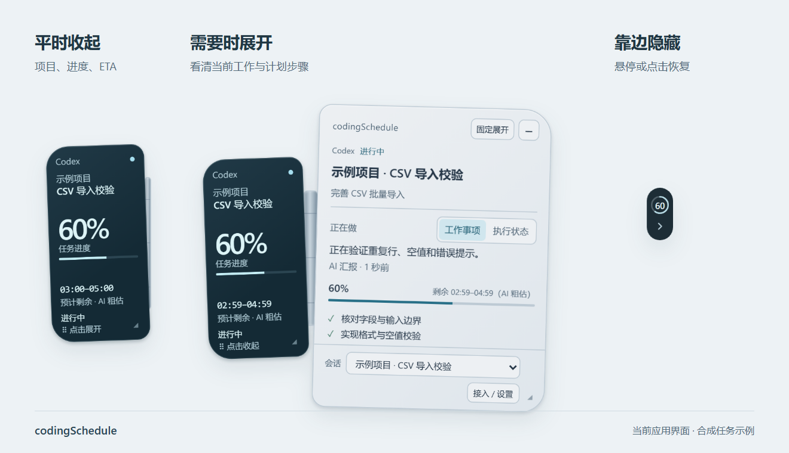
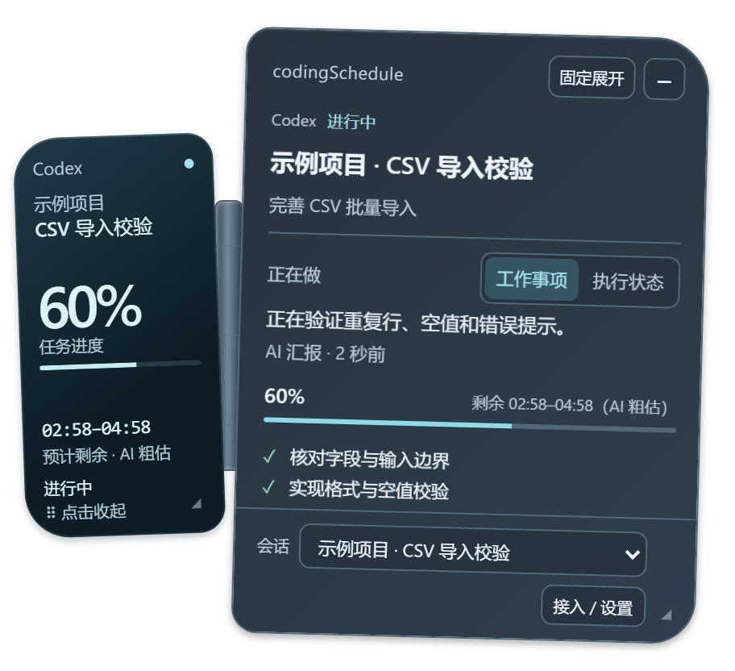

<div align="center">

# codingSchedule

### AI 在忙什么，抬眼就知道。

给 **Codex** 和 **Claude Code** 加一块桌面任务状态屏。

**Windows x64 · 本机运行 · MIT · 候选开发版**

[下载 Windows 预览版](https://github.com/wzwailr/codingSchedule/releases/tag/v0.1.0-preview.1) · [产品预览](#产品预览) · [快速开始](#快速开始) · [参与开发](CONTRIBUTING.md)

</div>



<p align="center"><sub>画面由当前应用界面渲染，使用隔离的合成任务展示。</sub></p>

把任务交给 AI 后，你可以继续做自己的事。codingSchedule 自动发现本机活动会话，把工具调用、AI 汇报的工作事项、计划和 ETA 放在同一个悬浮窗里。需要细节时悬停展开，暂时用不到就让它贴边收起。

## 产品预览

**收起时，一眼看状态。** 窄状态屏保留会话、进度和 ETA，可拖动、调节尺寸和不透明度。

**展开后，知道在做什么。** 详情翼展示当前动作、计划步骤、更新时间和来源，可固定展开、切换活动会话。

**靠近屏幕边缘，自动藏起来。** 小环扣保留状态提示，悬停或点击即可恢复。

<details>
<summary>查看深色主题</summary>



</details>

## 让等待变得有数

| 你想知道的 | codingSchedule 的显示方式 |
| --- | --- |
| 哪个任务正在运行？ | 自动发现 Codex / Claude Code 的活动会话，以「项目名称 · 会话名称」区分，支持自动跟随和手动切换。 |
| AI 具体在忙什么？ | **工作事项**显示 AI 主动汇报的内容，**执行状态**显示观察到的工具调用等动作，两种视角可切换。 |
| 还要等多久？ | 接收 AI 的 ETA 后持续倒计时，新估时到达时校正，模型暂时省略估时也会保留上一次有效计时。 |
| 完成了多少？ | 展示收到的计划进度，有效估时期间可随活跃时间推进显示。等待时冻结，超时会明确提示。 |
| 接入要配多少东西？ | 安装器默认提供 Codex / Claude Code 的 MCP、Skill、汇报规则和异步估时 Hook 配置，也可在设置中一键接入。 |

原始 AI 日志按只读方式观察，已有接入配置会核对和备份。后台汇报依赖宿主与模型配合，工具卡是否可见由宿主决定。没有可靠计划或估时时显示未知，AI 报告完成后仍与人工验收分别记录。细节见[使用说明](docs/user-guide.md)。

## 快速开始

**Windows x64 安装包约 25.8 MB**，自带私有 Node，安装时检测 WebView2 Runtime。

[下载安装包](https://github.com/wzwailr/codingSchedule/releases/download/v0.1.0-preview.1/codingSchedule-WebView2-0.1.0-setup.exe) · [发行说明与 SHA-256 校验文件](https://github.com/wzwailr/codingSchedule/releases/tag/v0.1.0-preview.1)

1. 退出正在使用同一数据目录的旧悬浮窗，运行安装包。
2. 按需保留默认的 Codex / Claude Code 接入配置，然后重新连接 AI 客户端以加载 MCP 和汇报规则。
3. 开始一个新任务，观察活动会话、当前动作和收到的进度与 ETA。

这是未签名的预览版，内存和部分环境验收仍在推进。首次缺少 WebView2 Runtime 时，微软引导程序需要联网补装。详细步骤见[使用说明](docs/user-guide.md)。

### 从源码构建

开发环境为 **Windows x64、Node >=24.15 且 <25**。在仓库根目录执行以下命令。

```powershell
git clone https://github.com/wzwailr/codingSchedule.git
cd codingSchedule
npm ci
npm run fetch:relay-compiler
npm run fetch:runtime
npm run package:webview2
```

WebView2 安装包生成在 `release/webview2-v1/`。运行安装包后，会检测共享 WebView2 Runtime，需要补装时通过微软引导程序联网完成，并提供双宿主接入配置。最终用户使用安装包时无需另外安装 Node。

| 构建选择 | 命令 | 产物 |
| --- | --- | --- |
| WebView2 候选 | `npm run package:webview2` | 安装器、私有 Node、运行环境检测。 |
| Electron 候选 | `npm run package:win` | 安装版和便携 ZIP。 |
| 本地开发 | `npm run dev` | 启动 Electron 开发窗口。 |

切换版本前请先退出使用同一数据目录的旧悬浮窗。完整步骤见[开发说明](docs/development.md)，接入和撤销方法见[接入说明](docs/integrations.md)。

## 当前进展

项目处于候选开发阶段，Windows 构建尚未签名。

- 已有活动会话发现、双翼悬浮窗、后台汇报、持续 ETA、贴边隐藏和一键接入实现。
- WebView2 完整进程树内存仍高于 **220 MiB** 目标。
- 高 DPI、多屏、缺少 Runtime 的干净环境和部分真实宿主流程仍有待验收。

各项证据和边界随 [WebView2 验收记录](docs/verification/webview2-migration.md)与 [V1 验收矩阵](docs/verification/acceptance.md)更新。

## 一起完善它

欢迎反馈复现步骤、使用场景和改进建议。提交前请对日志和截图脱敏，开发约定见[贡献指南](CONTRIBUTING.md)，安全问题按[安全反馈说明](SECURITY.md)处理。

[文档索引](docs/README.md) · [更新记录](CHANGELOG.md) · [第三方声明](THIRD_PARTY_NOTICES.md) · [MIT License](LICENSE)

项目自身代码采用 MIT，第三方组件保留各自许可。`package.json` 的 `private` 标记用于防止误发布到 npm。
