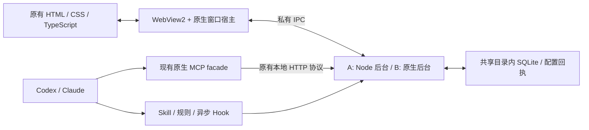

# WebView2 迁移评估

核验日期：2026-11-03。结论为源码、官方文档与本地载荷压缩测量基础上的工程评估，**尚未实现或实测 WebView2 悬浮窗**。本轮不修改生产实现、宿主配置或权限，不做数据库迁移/修复，不发布，不重启耐久；仅按既有规则正常汇报本任务。当前 Electron 候选继续作为可回退基线。

## 结论与建议

可以迁移，现有 HTML/CSS/TypeScript 界面和 Codex / Claude 的协议、规则、会话识别逻辑可以保留。关键障碍在原生窗口交互与后台 JavaScript 运行时，而非页面绘制。

建议采用 **共享 Evergreen WebView2 + 薄 Win32 宿主**，先保留一个 Node 后台完成低风险过渡，将安装包目标设为约28–40MB；如果最终必须小于约15MB，再迁移后台并移除 Node。两步沿用同一宿主和数据协议，不重复设计UI。不把过渡版承诺为几MB工具。

用户补充要求：**安装时自动检测环境、缺项自动补齐，一次安装后完成双宿主接入配置**。默认设计为在线安装器，不把“用户先装好Node/WebView2”作为前置步骤；下面的28–40MB等范围是完整应用组件包估算，在线引导文件与首次总下载另行测量。此要求已纳入方案，尚未实现新安装器。

宿主优先考虑直接控制 Win32/WebView2 的实现；语言建议 Rust，便于后续把后台放进同一原生工程。C++/Win32 可作为官方样例更直接的实现候选。Tauri 2 也可复用原前端并降低托盘/打包接线成本，但**普通透明窗口 API 不等于异形裁剪、局部点击穿透和不激活交互已经满足**，需同样通过窗口样机。若框架层无法通过，使用直接 Win32/WebView2，不以修改系统私有窗口类或牺牲现有行为绕过。

先投入2–3人日做有停止条件的原生窗口样机；只有通过最难的透明命中、焦点和拖动门槛，才开展正式迁移。评估范围仍为 Windows x64，其他平台不计入预算。

## 当前证据

| 项目 | 当前核验结果 | 说明 |
| --- | --- | --- |
| 现有精简包 | 安装包113,927,266字节；ZIP142,962,021字节；目录328,443,076字节 | 取本轮已生成v43的manifest与size/comparison记录 |
| Electron耦合 | `src/desktop/main.ts`、`preload.ts` 两个文件直接导入 Electron | 不代表只改两个文件即可完成迁移：生命周期、窗口原生能力、测试与打包均需适配 |
| 前端分发文件 | HTML 5,657字节、CSS 20,599字节、JS 62,544字节 | `dist/renderer`，可沿用，不引入React/AntD |
| 原生MCP转发器 | 24,064字节 | 不依赖Electron；可保留四工具stdio与本地HTTP契约 |
| 数据库 | schema版本5；Node `node:sqlite`，单写入者、事务和备份 | 单纯换壳无需重做业务schema；去Node则需等价重实现 |
| 本机共享WebView2 | 注册版本156.0.4314.58，机器级安装 | 只读注册表核对；未安装或升级运行时 |
| 本机WebView2版本目录 | 文件长度合计913,129,028字节 | 含运行时资源；未去重硬链接，不等于新增物理占用，也不是其他机器的固定大小 |
| 构建工具 | PATH探测发现dotnet；未发现cargo/rustc/cl/cmake | 不能由PATH缺失断言整机没装；本轮未安装工具链或编译原生宿主 |

本轮按 ant-design-ux 的反馈规范、Impeccable 的保留现有产品行为原则检查迁移验收：保留既有身份、信息密度、错误恢复与操作入口；不重新选择视觉方案。移动端/触摸适配建议不套用到这个Windows鼠标键盘工具。

## 预计体积及其依据

以下均为**工程估算，MB按1,000,000字节**。安装/ZIP范围含应用自身依赖与许可，排除共享WebView2、用户数据库、备份及WebView2用户缓存；未生成新宿主二进制，不能称为迁移实测包大小。

| 路线 | 安装包估算 | ZIP估算 | 应用目录估算 | 工作量估算 | 风险 |
| --- | ---: | ---: | ---: | --- | --- |
| A：WebView2宿主 + 现有Node后台 | 28–40MB | 38–50MB | 105–130MB | 合计10–16人日，约2–3.2个工作周 | 中高；窗口行为是主要风险，业务语义可大部复用 |
| B：同一宿主 + 原生后台，移除Node | 6–15MB | 8–20MB | 15–35MB | 从现在累计25–40人日，约5–8个工作周 | 高；需重实现状态、数据库、配置事务与Hook |
| 保持Electron v43 | 113.9MB实测 | 143.0MB实测 | 328.4MB实测 | 无迁移投入 | 当前已知实现和既有未验收项继续存在 |

工作量按一名熟悉Windows原生与目标语言的工程师、每人日约8小时，包含实现与定向回归；不是AI实际运行时长，也不是交付承诺。PoC结果、工具链、干净环境与高DPI问题会修正预算。B为累计值，不与A重复相加。

为避免凭空估数，本轮把现有Node可执行文件、collector/bridge/setup/remove bundle、前端、Skill/Hook和许可复制到隔离测量目录，以本机已有7-Zip工具、normal等级压缩：

- Node EXE：93,882,184字节。
- 测量载荷合计：96,715,988字节。
- 7z：23,187,003字节；ZIP：34,471,798字节。
- 测量脚本及结果：`.artifacts/webview2-assessment/measure-payload.mjs`、`payload-size.json`。

该载荷**没有**原生宿主、WebView2 loader、独立后台启动入口和新IPC，collector仍是旧Worker入口，所以不是可用的迁移程序。A估值在实测压缩载荷上预留宿主、IPC、安装器、引导程序及版本差异余量；7z不等于完整NSIS大小。B依据去除约94MB Node后的应用资产与优化原生二进制预算，可信度低于A，必须在PoC编译后重估。

### WebView2运行时不能藏在体积数字外

默认采用共享Evergreen：存在即复用；不存在时安装器检测后引导官方运行时安装。Microsoft说明Windows 11包含运行时，但仍要求检测缺失情况，Edge浏览器本身不能当作生产WebView2运行时替代。[官方分发说明](https://learn.microsoft.com/en-us/microsoft-edge/webview2/concepts/distribution)

嵌入小型bootstrapper的公开参考增量约1.8MB，但缺少运行时的首次安装仍需联网下载完整Runtime。完全离线且缺少运行时的机器需要额外完整离线包；Tauri文档的参考增量约127MB，随版本变化，不是本机当前版本下载实测。Fixed Version的二进制超过250MB，会重新带回大包问题，因此不推荐作为默认。[Tauri安装方式](https://v2.tauri.app/distribute/windows-installer/)

这次机器已有156版，可以复用而不因本应用再复制一套；本机约913MB目录长度不能当作本产品新增物理占用。未安装运行时的新机器必须另外计下载和安装占用，不能宣传“完整首次安装只需28MB”或“总共只有6MB”。运行时由系统/其他应用共享，卸载本工具不删除它。应用的UDF独立放可写用户目录，缓存与业务库分开核算。[UDF说明](https://learn.microsoft.com/en-us/microsoft-edge/webview2/concepts/user-data-folder)

## 保留与改造边界

| 部分 | 路线A | 路线B及关注点 |
| --- | --- | --- |
| 双翼/墨玉环扣 HTML、CSS、渲染与双视角 | 直接沿用；替换preload桥接适配器 | 继续沿用HTML/CSS/TS，无需转React |
| 几何、贴边、连续进度、倒计时 | 纯TS逻辑留在后台/浏览器，宿主接收统一几何 | 原生几何可按同一向量测试移植；前端计算不必全部重写 |
| Codex/Claude日志解析与活动会话归并 | 保留现有adapter和扫描/游标逻辑 | 移植解析器、增量游标、原生/reporter精确映射及子会话过滤 |
| 数据库/进度/ETA/mailbox | 保留现有Store及单写入者 | 保持schema和协议语义，迁移实现；先在副本比对，避免双写 |
| 四MCP工具及Win32 facade | 保留工具名、路由、凭据、ACK与断连恢复 | facade继续用；后台校验、错误、幂等、响应序列等价重实现 |
| Skill、默认规则、两类异步Hook | 保留文本与行为；脚本指向随包Node | 保留规则/协议；Hook改用限时的原生helper，不引入新模型 |
| 一键安装、修复、撤销 | 复用配置补丁、冲突、回执和备份模块 | TOML/JSONC局部编辑与回执合并难度高，需独立迁移与差分验证 |
| 托盘、单实例、聚焦、裁剪、透明度、缩放与显示器变化 | 原生宿主重接线 | 同一路径，不重复建窗口实现 |
| Playwright Electron测试 | 保留纯DOM与业务测试；Electron驱动替换 | 新增WebView2/原生驱动，不能拿旧Electron通过数冒充新宿主通过 |

前端保持 `window.schedule.subscribeSnapshots` / `dispatchUiCommand` 两个接口；通过WebMessage关联有界request/reply与超时，不开放任意文件、shell或网络代理。原生宿主验证文档来源、命令种类、真实焦点，再通过私有IPC转发；不能相信JS声称“当前已聚焦”。保留本地静态来源/CSP、禁用外部导航与弹窗，凭据/私有handle不进入页面。[WebView2安全建议](https://learn.microsoft.com/en-us/microsoft-edge/webview2/concepts/security)

路线A仅一个Node后台承接采集、Store和SDK服务，原生宿主管理它的创建、退避重启、异常退出与结束清理；MCP实例仍是轻量facade，绝不每个MCP起一个Node。独立宿主与后台必须计入完整进程树，不能沿用旧PID口径宣称内存改善。

## 悬浮窗迁移的关键风险

| 风险 | 为什么不能简单替换 | 方案与验收 |
| --- | --- | --- |
| 透明、阴影与不透明度40%–100% | WebView2背景alpha只支持全透明/不透明；背景透明不代表整窗合成与鼠标透明 | 透明背景配原生合成层；整窗alpha另验。双翼、铰链、胶囊区域由同一几何源驱动，初次加载不闪白；保持真实字体与浅深主题 |
| 空白透明区吞点击 | HTML的透明像素仍可能属于宿主矩形；`HTTRANSPARENT`仅说明同线程下层查找，不能据此证明能点穿其他应用 | 通过真实HWND region/原生合成命中限制可见轮廓；用独立后方应用检验圆角、翼间及四边空白点击，不全窗忽略鼠标 |
| 不抢焦点与设置可输入 | 悬停/状态按钮与可聚焦设置是两种行为，WebView子窗口可能激活父窗 | 显式查看/编辑模式；Win32激活消息与Controller焦点协同，前台窗口句柄实测。设置可Tab/Enter/Esc与IME，退出设置恢复不激活 |
| 拖动/捕获/离屏 | 组合式承载需转发mouse/pointer、leave、capture，API成功不代表内容仍响应 | 按事件当时坐标计算，DIP/物理像素转换一致；100次快速跨边界拖动与释放，失焦/cancel后不粘住；四边恢复锚点稳定 |
| Evergreen更新回归 | WebView2升级独立于本应用，透明输入与捕获有公开问题线索 | 记录运行时版本、特性探测；在目标稳定版执行短原生回归。问题未复现/修复前不声称兼容；不靠固定大运行时掩盖包体 |
| 包体下降但内存上升 | WebView2仍是浏览器、renderer、GPU等多进程；A多了一个Node后台 | 正常/峰值与全部后代计量，沿用既有三MCP/220MiB资源目标作为待验门槛，不预先承诺达标 |
| 数据及配置回归 | SQLite事务/JSON序列化/回执内容/旧路径与文件锁有历史敏感性 | 原库一致性备份，副本迁移、状态向量比对、单写入者锁；受管接入迁移保留审批字段与用户原文，冲突停止；旧MCP长连接跨后台重启验证 |

依据：[透明背景限制](https://learn.microsoft.com/en-us/microsoft-edge/webview2/reference/win32/icorewebview2controller2?view=webview2-1.0.774.44)、[组合承载与输入转发](https://learn.microsoft.com/en-us/microsoft-edge/webview2/reference/win32/icorewebview2compositioncontroller?view=webview2-1.0.3537.50)、[SetWindowRgn](https://learn.microsoft.com/en-us/windows/win32/api/winuser/nf-winuser-setwindowrgn)、[WM_NCHITTEST](https://learn.microsoft.com/en-us/windows/win32/inputdev/wm-nchittest)、[进程模型](https://learn.microsoft.com/en-us/microsoft-edge/webview2/concepts/process-model)。

官方反馈仓库中[#5695](https://github.com/MicrosoftEdge/WebView2Feedback/issues/5695)、[#5712](https://github.com/MicrosoftEdge/WebView2Feedback/issues/5712)在本次检索仍为Open，报告152版组合承载反复拖出后输入失效。它们是原报告者的版本特定线索，**不证明本机156版或本项目也受影响**；因此把对应动作纳入PoC，而不是宣布WebView2不可用。

参考源码已读Microsoft的 [ViewComponent.cpp](https://github.com/MicrosoftEdge/WebView2Samples/blob/main/SampleApps/WebView2APISample/ViewComponent.cpp)：透明背景、DComp视觉树、输入转发、capture和DPI适配可作为API接线参考。文件头称BSD-style，但根目录与样例目录LICENSE的直接路径本轮返回404；当前仅参考API，不复制源码。实施时需固定commit并找到有效许可后才复制具体片段，不能自行标MIT。Tauri [Node sidecar文档](https://v2.tauri.app/learn/sidecar-nodejs/)证实可随包运行Node，但不会自动去除运行时体积；本项目不为此先引入pkg或换数据库。

## 路线A实施顺序与门槛

| 阶段 | 工作与产物 | 人日 | 进入下一阶段的条件 |
| --- | --- | ---: | --- |
| 1 原生窗口样机 | 固定SDK/编译链，接入现有前端；验证形状、透明、alpha、无焦点/设置、四边拖动 | 2–3 | 真实Windows输入、透明区点击与焦点全部过；第3人日仍有基础阻断则暂停迁移并修订方案 |
| 2 宿主与UI桥接 | 单实例/托盘、统一几何、WebMessage契约、固定/收起、缩放、主题与显示器事件 | 3–5 | 两态与设置全路径、长文/空态/多会话、Esc/键盘和偏好重启恢复通过 |
| 3 后台与双宿主接入 | Node独立入口、进程监管/IPC、原生MCP、异步Hook、自动监测与一键接入 | 2–3 | Codex/Claude分别通过真实stdio、精确会话归并、ETA连续/等待冻结、安静失败与恢复；不唤醒业务会话 |
| 4 安装/数据升级 | Evergreen检测与缺失处理；同用户目录、锁、备份、旧路径迁移与安全撤销/卸载 | 1–2 | 空白用户/缺Runtime/断网/配置冲突/运行旧版本/旧MCP锁文件的受控路径通过 |
| 5 回归与本地候选 | 原生+DPI/多屏可用场景、包体/完整资源短测、截图、manifest、回退演练 | 2–3 | 全部已选验收项有证据；未能实测的硬件项明确未验，不视为通过 |
| 合计 | 含窗口PoC、实现与定向回归 | 10–16 | 不包含发布、等待外部资源或八小时耐久 |

一键接入仍对Codex/Claude共八组件负责：MCP、Skill、默认规则、异步Hook各四项。A的Hook恢复使用随包Node，B使用原生helper；移除Electron环境前缀仅改自身受管项，保留其他审批字段/Hook/规则。保持只读日志自动发现与活动session投影；技能仍只能提高模型按要求汇报的概率，不能由换UI内核保证每次上报。普通续报不要求每次ETA；最近有效范围继续倒计时，等待冻结，估算进度上限99%，实报/AI完成/人工验收分开。

安装拟采用“检测Runtime → 已存在则复用 → 缺失时官方bootstrapper及签名核对 → 当前用户安装 → 再检测 → 配置双宿主并启动”。网络失败不能靠没有WebView2的设置页提示，应由原生安装器给出可恢复结果；不绕过企业策略、不默认提权。当前已运行AI宿主不被重启，旧MCP目录不在仍被引用时删除。是否需要宿主在方便时重新连接按实际路径变更说明。

### 安装时自动检测与补齐：必需交付行为

用户入口只有“运行安装器 → 点击安装 → 查看结果”。不出现要求用户选择使用哪个AI、判断Node版本或复制MCP/Skill文件的必要步骤。可保留安装路径与默认勾选的双宿主接入选项，允许用户取消接入，但无需逐项配置。环境检测本身不等于后台静默升级共享组件；用户启动安装后，仅对缺失/不满足本应用最低能力要求的组件进行必要补齐。

| 检测对象 | 自动判断 | 安装器行为 |
| --- | --- | --- |
| Windows/架构/安装目录 | OS、进程及系统架构、目录可写性和空间 | 本轮支持Windows x64；不支持的架构/系统提前说明。拒绝架构错配，不让用户自行猜下载版本，不默认提权 |
| 已有应用/数据/后台 | 原版本、同一数据目录是否被占用 | 复用用户目录与偏好；需要替换本工具运行文件时延后或提示退出本工具，不能强杀AI宿主或并发写库 |
| WebView2 Runtime | 机器级/用户级注册信息、可用生产Runtime版本及必须API | 已可用直接复用；缺失或不足时按官方流程安装/更新，再检测。不能把已有Edge浏览器或仅注册表残留视为成功 |
| Node后台依赖（路线A） | 本应用私有运行时的固定版本、架构、文件完整性 | 完整则复用；缺失则下载校验后的固定组件到应用目录。无需系统Node、不写PATH、不依赖其他AI工具内部的Node。路线B跳过该项 |
| Codex/Claude配置位置 | 标准用户目录、显式自定义路径、已有本工具条目/回执 | 默认同时准备两宿主的MCP、Skill、默认规则与异步Hook；保留其他配置。无法可靠确定自定义目录时标明待核对，不能猜路径后宣布接入成功 |
| 配置可合并性 | TOML/JSONC有效性、同名冲突、审批字段与用户后续编辑 | 对兼容项沿用，对自有缺项补齐并备份；冲突保留原文，单独报告“需要处理”，不为达到一键成功而覆盖 |
| 安装后就绪性 | Runtime创建、后台/SQLite健康、原生MCP目录及配置组件 | 分开显示应用可运行、配置已写入、连接已验证、宿主需重连；独立stdio自检不冒充当前聊天工具已刷新 |

WebView2检测使用Microsoft推荐的注册信息/API，并验证实际运行时可创建及所需能力；最低要求在PoC后根据真实使用API确定，不把SDK版本号直接当作Runtime版本。自定义环境变量引入的预览浏览器不能被错误当作生产运行时。[官方检测与安装流程](https://learn.microsoft.com/en-us/microsoft-edge/webview2/concepts/distribution)

AI工具尚未安装时，可在标准用户目录预配置接入，结果显示“配置已准备，等待宿主加载”，并允许以后重新检测/修复。安装器不代装Codex/Claude、不自动登录或唤醒业务会话；已运行宿主需要加载新配置时，仅说明在方便时重新连接，不打断主任务。安装完成后继续自动检测活动session，无需选择监测哪个AI。

默认在线安装器按需补齐WebView2；路线A的私有Node可随应用携带，也可拆成按需下载组件，用户都不需要手动准备。已有合格组件不会重复下载。上表28–40MB及10–16人日仍以Node随包的完整组件包为基线；若把Node另做在线组件，需要额外的组件清单、缓存、校验和恢复验证，初估再加1–2人日，样机后统一重估。引导文件大小必须在样机打包后给实测，不能把它冒充完整产品下载体积。向用户分别展示：安装器下载量、当前缺失组件预计下载量、应用占用、共享Runtime占用。完全离线版作为单独的大包选项；没有离线组件且断网时不承诺“自动安装一切”。

安装器在原生界面显示有意义的阶段：检测环境 → 下载所需组件（有Content-Length时显示真实字节进度）→ 安装运行组件 → 配置Codex/Claude → 检查结果。无可靠总量时显示当前阶段，不伪造百分比；网络超时、取消、签名/散列失败、企业策略阻断或安装返回非成功时停止当前依赖步骤，保留已有程序和配置，提供重试/取消及明确原因，不无限重试或自动绕过策略。

下载必须落到临时文件，核对官方来源/签名或固定组件散列后再使用；中断后重试复核缓存，不执行残缺文件。WebView2成功安装后重新检测，不能仅以子安装器退出码判断就绪。依赖未就绪不启动空白WebView窗口；宿主接入冲突则可以保留可用的原生日志监测，但结果不得显示“全部完成”。

自动检测的验收矩阵至少覆盖：①有Runtime且无Node，②两者均缺失，③已有兼容组件不重复下载，④残留注册项/损坏组件，⑤非管理员与企业限制，⑥断网、下载中断/取消和恢复，⑦已安装宿主/自定义目录/宿主未安装，⑧旧版应用运行和MCP文件锁，⑨配置冲突/回执撤销，⑩重复安装与完整卸载。全部在隔离用户/目录或干净VM中验证，保留原配置与版本/下载/结果证据；本轮仅定义这些验收，不执行环境安装。

数据库继续使用现有共享进度目录，UDF另建子目录；拒绝Electron旧进程与新后台同时写同一个库。备份必须包含WAL的一致性，回退使用备份/副本，不让旧应用读取已升级的库。初期保持schema v5，确需变更再单独定义迁移。

## 路线B额外投入

在A宿主不变的基础上，再投入约15–24人日：domain/ETA/adapter/storage等价移植6–10、协议/校验/幂等与精确绑定4–6、配置/回执/Hook helper迁移3–4、跨实现差分及恢复回归2–4。从现在累计25–40人日。

尽量保留SQL结构、事件JSON与Schema向量，复用纯前端和原生facade。Node与Rust/C++在JSON数字/顺序/字符串、时钟、路径和文件原子写入上有差异，特别是回执摘要、ACK重试与SQLite提交顺序，要用同一事件流分别运行旧新实现比对。原有TS测试可作验收oracle，但不能直接算作新语言实现的测试通过数。移除Node前，安装/卸载/Hook必须全部脱离它，否则只是把大依赖转移成用户前置安装。

## 本轮完成范围与下一步

已完成当前源码与依赖边界、官方API/分发及样例审阅，本机Runtime只读检测、现有载荷两种压缩实测和上述方案。只新增本评估与隔离测量材料，未编译/运行新的WebView2宿主，没有迁移验收截图，不声称焦点/裁剪/IME/DPI或内存已通过。

最小下一步是阶段1的独立原生窗口样机；同时把原有进度/ETA/会话/双宿主行为作为固定输入，先验窗口能力，不改业务库、不改已装宿主、不启动耐久。之后用样机实际包体与完整进程树修正A/B估算，再决定是否实施正式迁移。
