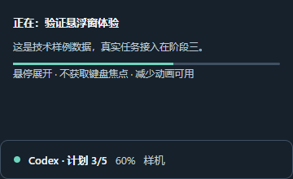

# M0 本机能力矩阵
验证：2026-10-26。阶段一已完成核心技术验证，仍有补充验收未完成；当前不能把整个阶段勾为完成。

## 版本与机器
Windows11 10.0.26100、x64、32GiB RAM、20逻辑处理器。实际只有一个1920×1080、100%缩放显示器（workArea1920×1032）。
Electron45.0.0、其内置Node24.22.0、SQLite3.53.4；开发Node24.18.0；TypeScript6.0.3；MCP server/client/core2.4.0；Zod4.6.7；Vitest5.0.5；Playwright1.64.1；electron-builder26.18.0。精确依赖由lockfile锁定。

## 结果矩阵
| 检查 | 结果 | 实际证据与限制 |
| --- | --- | --- |
| Electron支持的版本及依赖可安装 | 通过 | 本机安装、构建和目录打包成功 |
| utilityProcess内node:sqlite | 通过 | 真事务回滚、关闭重开读回7；无外部SQLite原生addon |
| 包内独立Node与MCP | 通过 | PATH仅包内runtime、SystemRoot；initialize/tools/list/callTool成功，probe_ping返回probe-ok |
| 中文与空格路径 | 通过 | 包及其runtime经.artifacts/中文 路径目录别名启动；非跨机器安装证明 |
| Node归档完整性 | 通过 | 官方v24.22.0 win-x64 zip SHA-256 f9683a19877e12a9b167305c8db71040d812876359de21f0d2e97c3f321f80c3；保留完整LICENSE |
| renderer隔离参数 | 通过 | nodeIntegration=false、contextIsolation=true、sandbox=true |
| 原生hover与不抢焦点 | 通过 | 单屏100%下20次真实Win32鼠标进入/离开；GetForegroundWindow始终不变；GetClientRect为48/220px |
| 实际输入与hover混合 | 未通过验证 | 临时参考输入窗口的可见/焦点/遮挡检查不稳定；一次SendKeys路径在第2轮未按时展开。后来改用SendInput的路径被遮挡保护终止，未能完成20轮；不能记为产品输入PASS |
| 物理150%DPI与多屏 | 未验证 | 当前没有该显示环境，不更改用户系统缩放或伪造物理显示器 |
| Codex日志可读与身份字段 | 通过结构探测 | codex-cli0.154.0，读取最近3个JSONL的有界头/尾；发现session_meta.payload.id/session_id、turn_context.payload.turn_id、response_item.payload.call_id |
| Claude日志可读与身份字段 | 通过结构探测 | Claude Code2.1.278，最近3个JSONL；发现sessionId、assistant/user/system、tool_use结构 |
| Hook/正式工具接入 | 未联调 | 不修改宿主现有设置；真实Hook、正式MCP四工具及第三宿主接入属于后续任务 |
| 常驻资源初值 | 已记录 | 可见样机+Playwright连接时Private Bytes约174.64MiB；SQLite探针已退出、无常驻MCP桥，不能当作完整产品预算或五分钟基准通过 |

## UI/UX技能应用
使用ui-ux-pro-max。两次design-system搜索给出的营销页结构不匹配悬浮工具，未套用；采用命中的focus states/焦点不遮挡规则与通用高对比、系统字体、状态文字、减少动画建议。正式键盘入口和托盘交互仍在T08实现，样机不能替代这些功能。

原生测量发现GetWindowRect含不可见边框，实测外框56/228px；改用GetClientRect检查可见客户区48/220px。不是修改验收尺寸来抹掉失败。实际输入测试保留失败记录，不采用“DOM有按钮”作为Windows输入成功的证据。

## 后续补验步骤
1. 在记事本或其他普通输入框连续输入时悬停20次，确认焦点、字符与展开/收起均稳定；记录实际输入法和前台句柄。
2. 真实150%显示器及混合DPI双屏，检查边界展开、窗口位置、屏幕拔插与恢复。
3. 阶段三真实数据链路和后续完整进程树性能验收另行记录。

首发技术路线继续采用Electron+TypeScript+node:sqlite；现有证据没有要求换壳。阶段二不依赖未完成的物理输入/DPI测试，已单独实现验证；进入阶段三前继续处理这些界面门槛。
