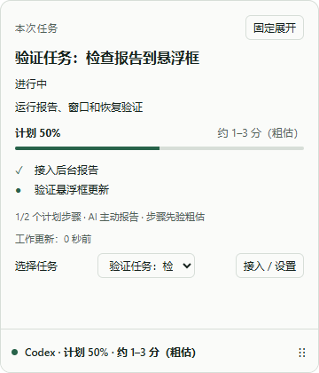
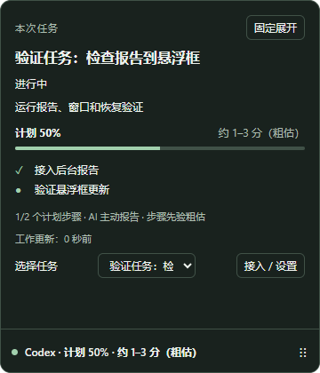

# 阶段三、四实施报告
日期：2026-10-26。范围：T04–T11。原底座提交 0f0c1b9，候选实现提交 9d06061；后续修复与交付记录以 Git 和本报告为准。

## 当前结论
阶段三、四主要代码已实现，已接通日志/Hook → 标准事件 → 真实 SQLite → 正式悬浮框，以及 MCP/CLI 报告到窗口的通路。默认启动入口已从固定数据样机切为产品窗口。完整阶段验收未关闭：真实新 AI 任务、Skill 自动触发、原生输入/物理 DPI/多屏等仍缺证据。阶段五未交付。

## 实现
| 任务 | 内容 | 证据边界 |
| --- | --- | --- |
| T04 | 有界增量读取、UTF8/CRLF半行、截断/换代、游标指纹、发现限制 | 100MiB 合成文件及真实 IO 字节计数，不是大历史库耐久 |
| T05 | Codex计划调用与 exec 字面量、Claude TodoWrite/Task*、跨块 checkpoint | CCAM 固定 SHA 单元复用，本地回归通过，未运行上游完整测试 |
| T06 | loopback 鉴权、Host/Origin/64KiB/速率、Hook截止、批次/断点原子提交 | 真实 HTTP/SQLite 与合成来源，不自动安装宿主 Hook |
| T08 | 单悬浮框、hover250/leave400、拖动/任务选择、托盘焦点、同窗口设置 | Playwright Electron 真进程；本轮 OS 原生焦点测试无法执行 |
| T07 | SDK2 四工具、CLI、独立小 Skill、明确 run handle | 官方客户端测试，不代表模型会主动按时调用 |
| T09 | active 尝试计时、remaining 版本锚点、至少3样本中位校准 | 算法精确断言，不代表实测 ETA 误差或统计置信区间 |
| T10 | TOML/JSONC预览/备份/hash/撤销、每轮明确关联/解除、用户验收 | 临时配置 UI 往返通过，未修改真实宿主配置 |
| T11 | watch+poll单写、退避、1/2/5重启、健康、7/30天保留、容量压力 | 真实写锁失败/ACK重试和有效页预算；未实际耗尽磁盘 |

## 本轮验证
- 首轮整套 25 文件/67 项通过，typecheck、lint、build、verify:origins 通过；审阅修复后必须重新运行全套，以最终命令结果为准。
- 官方 MCP 客户端在同连接使用两 run、重复回执、MCP→CLI context 重连通过。begin/report/context/finish 不按 cwd 或最近任务路由。
- 每秒100事件持续10秒，共1000条事件均获 ACK 且写入；另一 connector 可独立查询。指标是事件数，限流按请求计，二者未混用。
- 真实 SQLite BEGIN IMMEDIATE 写锁使 API ACK失败；解除后同 reportId 重试只提交一次。
- 开发和未签名目录包均通过包内 Node+限制 PATH 的正式 MCP 报告到 renderer，合成任务显示计划50%，无 page error。该探针不发起付费模型请求。
- 只读现存日志格式探针：Codex发现16、抽3文件212记录；Claude发现1、抽1文件198记录。两来源解析出轮次和动作；本次样本没有原生计划事件，因此不声称真实原生计划链路已验收。原始输出只保留汇总数量。
- 生产原生 hover 探针因 GetForegroundWindow 为0而无法运行；没有把阶段一旧样机20次成功复用为产品证明。

以上截图来自合成 MCP 任务，不包含用户原始聊天内容。

## 独立审阅
一次独立只读审阅提出4项 Important，无已证实 Critical；无 deferred minor。
1. 同 inode 截断并迅速增长至原长/更长会漏读：增加持久有界头/游标附近内容指纹与 schema v3 迁移，补等长、增长、半行不混合测试。
2. 旧原生 Stop 的 paused 选择阻止新轮次展示：仅保留整体任务的暂停选择；hover/pin/手动选择仍冻结切换。
3. 重启耗尽后设置依赖 worker，重连按钮无法显示：本地设置可在离线时返回；设置和托盘均可显式重连，并隔离旧 worker 的迟到退出/消息。
4. 跳过记录仍显示完整计划：原生 source.diagnostic 与 sourcePartial 持久化，计划降为未知并显示“部分记录未解析”，后续可信完整计划恢复。compact 健康提示同时保持可见。

四个问题均先以新回归观察到失败，再修复；其中重连测试实际强杀4次 utilityProcess 后通过 UI 重连。没有再派同范围二次审阅；修复由对应回归及全套验证闭合。

## 实施裁定与限制
- 继续既有专用目录/分支，不创建重复 checkout；本地 checkpoint，无远端 push。
- 沿用执行账本；计划为 T01 标题而技能脚本匹配 Task N，直接记录任务/裁定。
- 只复用 CCAM 固定提交的 locator、受限 literal parser 与消息归一适用部分；不移植原始日志归档/删除或 turn end 清空 reducer。实际 origins 和 MIT 全文已入库。
- 公共 Store 补内部 native turn映射、事务批次、时钟tick、本地验收、链接及维护接口；不能由模型自报 TrustedSource/canVerify。
- SourceObservation补稳定nativeSequence，TailBatch区分载荷bytesRead与总ioBytes；Discovery显式给出不可用来源。Git属性固定受散列追踪单元的LF并保留上游许可原始字节，避免Windows换行转换使origin校验漂移。
- 原生 parser revision 随文件换代重建；仓储在应用状态时分配连续任务 revision，原始事件仍按稳定身份保存。
- Codex MCP 实际格式为 TOML，取代早期 codex-mcp.json 文件设想。采用 smol-toml 验证，保留 owned marker 外原文；JSONC 使用结构化文本编辑。构建选择 jsonc-parser ESM，避免 UMD require 别名漏打包。
- Hook 无可信 turn 时只关联精确已知 call；缺失的生命周期留诊断，不按当前会话 head 猜测。设置不自动安装 Hook 或全局 Skill。
- 时间 tick 与实际工作更新分开。无依据/并行/不完整/连续性丢失/超原估计时 ETA 未知；窗口不承诺秒级倒计时。
- 指纹只读固定上限的文件头及游标附近字节，不能检测所有任意中部改写；宿主源应是追加日志。没有扩大为每次全量 hash。
- 窗口bootstrap与有限IPC留在desktop/main，纯几何提取到geometry；发现/解析类型在adapters公共层统一，不创建仅转发的空壳文件。内部接口裁定以实际实现和本报告为准。
- 配置 hash检查+rename不是与不合作进程共享的原子 CAS，最终微小竞争窗口仍存在，备份保留。
- 未实际执行：真实新Codex/Claude生成任务、第三宿主、自动Skill触发率、实体键盘/中文IME、物理150%DPI、多屏拔插/睡眠、磁盘完全耗尽、最终资源及耐久、安装升级卸载和签名。它们不能由当前测试推定通过。
- 首轮部分测试由缺模块开始失败；后补安全/恢复断言只按实际执行证据描述，不把所有测试追溯为完整TDD。

## 可重复入口
见[运行说明](../development.md)、[接入说明](../integrations.md)与[复用清单](../../third_party/origins.json)。.artifacts/widget 和 live-format 保存本机汇总证据，Git 忽略；release/win-unpacked 是未签名目录包。

## 最终复核
修复后：28个测试文件、73项全部通过，typecheck、lint、build、verify:origins（3个单元）和文档链接（9篇/25链接）通过。v2→v3迁移保留半行字节及待匹配工具调用；限流40请求burst、每秒20补充、429和connector隔离通过。

最终目录包重新构建通过。2026-10-26 18:13（Asia/Shanghai）开发/包内Node正式MCP到renderer再次通过，计划50%可见、page errors为空；截图已刷新。本轮OS原生焦点/输入无法执行的状态保持不变，不将候选实现标成完整阶段验收或V1交付。
