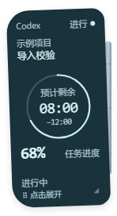
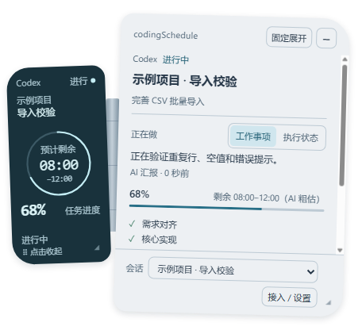
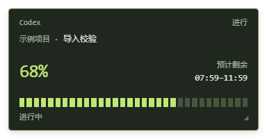
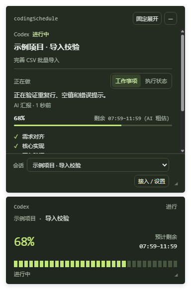
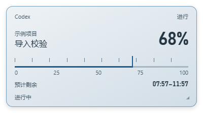
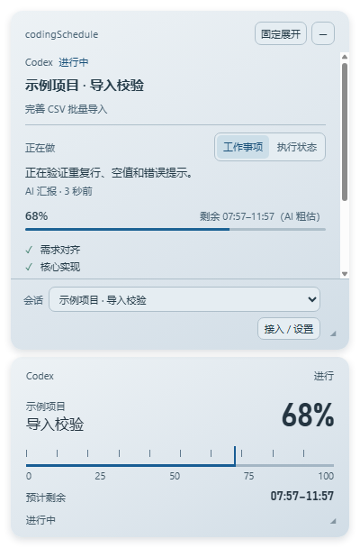
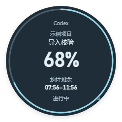
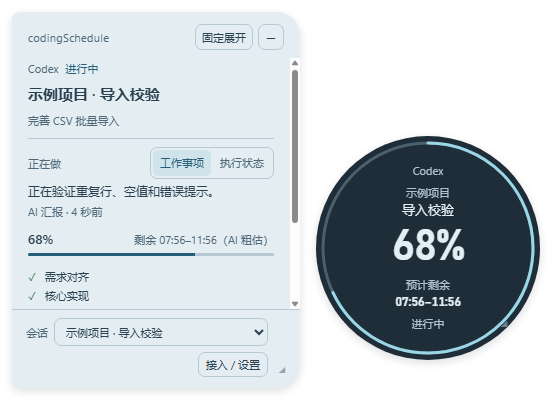

# 四主题切换与窗口验证

日期：2026-11-09。首轮候选 `release/themes-v1`，原样式恢复候选 `release/themes-v2`；均未推送、未发布。

## 使用与外观

打开托盘“接入 / 设置”，在顶部“悬浮窗主题”切换。选择保存到个人数据目录的 `theme.json`，不修改接入配置、进度库、尺寸或不透明度设置。没有此文件或主题值无效时继续使用原来的时光舷窗；已保存的三种新主题仍原样加载。保存失败会保留当前主题并提示重试。

| 主题 | 收起 | 展开 | 贴边 |
| --- | --- | --- | --- |
| 时光舷窗 | 原双翼左屏、舷窗内双行倒计时；124×248 DIP 状态屏 | 倾斜双翼、可见铰链、侧向展开 | 墨玉环扣、环形进度 |
| 像素终端 | 深色终端、绿色栅格进度；360×176 DIP 状态屏 | 上下展开深色详情 | 像素边条、细进度刻度 |
| 银砂仪表 | 冷银金属、蓝色测量游标；376×200 DIP 状态屏 | 上下展开金属详情 | 金属边条、细进度刻度 |
| 冷银冰蓝 | 冰蓝环、清晰数字；224×224 DIP 状态屏 | 优先侧向展开浅色详情，空间不足改上下展开 | 圆润环扣、环形进度 |

以上为100%状态屏尺寸；外层透明边距由窗口几何计算，不算业务点击区域。四套主题均支持35%–200%尺寸、既有三档密度。原样式的收起窗口为148×272 DIP，完整展开为456×416 DIP，详情保留系统浅深配色；新增三种主题保持各自材质配色。

以下截图来自真实 Electron 渲染窗口，使用隔离的合成任务数据，便于审核视觉；68%和示例文字属于测试输入，生产界面始终读取真实快照。

| 主题 | 收起 | 展开 | 贴边 |
| --- | --- | --- | --- |
| 时光舷窗 |  |  |  |
| 像素终端 |  |  |  |
| 银砂仪表 |  |  |  |
| 冷银冰蓝 |  |  |  |

## 数据与交互

- 四套主题复用同一组渲染控件和任务快照；计划进度与 ETA 独立表达。计划100%不会覆盖仍有效的倒计时。
- 未收到新估时时继续原倒计时，等待/暂停时冻结，更新过期或超时不判定任务失败。AI报告完成与人工验收分开显示。
- 保留活动会话切换、工作事项/执行状态切换、固定展开、Esc、拖动、尺寸角标和不透明度操作。
- 原生窗口尺寸和命中区域随主题同步。圆盘角落、透明边距和详情间隙从输入区域排除；展开时保留跨间隙的悬停意图。
- 原样式恢复了双翼角度、铰链和内置舷窗；新增主题样式限定于各自主题，不再替换原样式。未引入UI框架、字体下载或动效库。

## 验证证据与边界

原样式恢复后，10个文件31项相关回归通过，覆盖四种主题的切换/重启保存、默认兼容、三态与密度、异常状态、缩放、锚点、贴边和系统浅深配色。贴边用例按真实光标位置选择较远的测试位置，避免测试窗覆盖光标而正确触发“悬停时不隐藏”；没有修改这项产品行为。下列首轮记录保留其原版本和范围。

检查记录在忽略目录 `.artifacts/themes`。类型检查、lint、构建与本地安装包生成完成。

- 最终主题/几何/密度回归：6文件、24项通过；已修正旧测试的交互回归：6文件、10项通过。首次扩大检查的8项失败均属于已列出的旧布局假设与隔离夹具问题，均在这两批中复验通过；另有3项既有平台/探针跳过，未作为通过计入。
- `npm run typecheck`、`npm run lint`、`npm run build`、WebView2原生构建和安装包生成通过；文档47份、159个本地链接检查通过。Impeccable的5处小功能文字警告已修至11px；仍提示小工具11px正文及刻度用重复渐变，结合已选紧凑仪表设计保留，不作为完整可访问性认证。
- 最新版已用真实个人数据目录启动，位于屏幕右侧贴边位置。数据库 `quick_check=ok`，启动前516条任务记录保留，采集恢复后记录增加。当前聊天的原生MCP调用恢复成功，进度/有效估时已提交，SQLite只读检查确认与原会话存在关联。
- 本地安装包：25,798,418字节，SHA-256 `83331df086fdb78ebc2d1d1725d7823abbeec2a26594e24a59d13a959ff34b76`。未签名，本轮未推送或发布。

相关回归覆盖主题偏好保存/失败恢复、两种AI提供方、三档密度、长身份、未知计划、未知ETA、等待冻结、过期、超时、失败/完成、活动双视角、折展锚点、缩放手势和原生输入区域。早期依赖旧矩形尺寸/颜色的断言已按新几何更新，活动列表测试使用中央位置隔离默认贴边隐藏。

WebView2 使用打包后的真实原生入口和隔离数据目录，Codex / Claude 各通过真实stdio客户端执行四个MCP工具。验证进度50%、有效估时、下次省略估时后保留倒计时，以及等待状态/冻结估时重启后保留。

原生窗口验证通过限定到独立测试进程的Win32鼠标消息，经过宿主转发、WebView2事件和正常界面命令链路验证折展/贴边恢复；检查实际窗口边界、原生区域与前台焦点保持。该证据**不等于物理鼠标手测**。前两套主题已保留桌面像素截图；最后阶段桌面锁屏导致 `CopyFromScreen` 被拒，最终三主题原生回归以边界/命中区域元数据为准，圆盘完整三态视觉由上方Electron截图补充。没有解锁桌面、抢焦点或修改权限。

未新做物理鼠标、真实高DPI、多屏切换、输入法或读屏器验收；干净环境安装和长时内存测试没有在本轮重做。耐久测试没有重启，Codex/Claude宿主MCP和权限没有修改。

修复版补验：打包WebView2真实窗口的运行、等待和贴边恢复均通过，三态有实际桌面像素截图，Win32定向鼠标消息后的焦点保持；Codex/Claude真实stdio、估时省略后保留和等待冻结重启均通过。截图须等待原生组合帧提交，不能仅在窗口尺寸变化后立即采样。证据 `.artifacts/themes/native/restore-proof.json`；仍不等于物理鼠标、高DPI或多屏验收。修复包25,794,367字节，SHA-256 `078cc7994cf48bb131ca40b80fcf57f915d93ae608c1936695fcd45a3e9534ec`。

修复版已以真实个人数据目录启动；原有尺寸/透明度与主题选择未重置，无主题偏好时恢复原样式。现用进度库quick_check正常，重启后的当前聊天MCP继续成功，真实贴边恢复命中及焦点保持复核通过。

统一名称与重启（themes-v3）：四个显示名统一为“时光舷窗 / 像素终端 / 银砂仪表 / 冷银冰蓝”，各四字；主题内部键和已有偏好不变。7项主题回归、类型检查、lint、构建通过。旧应用和旧Node采集后台均已退出，新应用/后台已启动，当前MCP继续可用，数据库quick_check正常。耐久保持关闭，未推送发布。

后续本地候选修复了外部自动收起、小圆盘过期进入事件和缩小后变矩形；裁剪平滑边缘已调整，原生像素仍待桌面可访问后补验，见[交互与裁剪修复](window-interaction.md)。

2026-11-09解锁补验：时光舷窗100%与冷银冰蓝100%/35%的真实原生像素、区域/焦点及倒计时检查通过，边缘对比见[交互与裁剪修复](window-interaction.md)。此前的“原生像素待验”状态已解除，物理鼠标/高DPI/多屏未新增验收。
