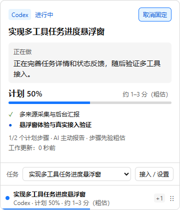
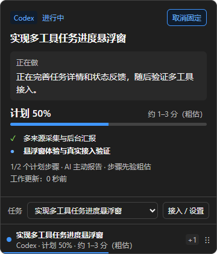

# 紧凑悬浮窗改版验证

日期：2026-10-27。用户选择紧凑进度条并授权直接细化实施，阶段五继续推进。设计和实施记录见[设计](../superpowers/specs/2026-10-27-floating-widget-redesign.md)、[计划](../superpowers/plans/2026-10-27-floating-widget-redesign.md)。

## 已交付界面

收起仍为 320×48 DIP，第一行显示任务名，第二行显示来源、计划进度和粗估剩余时间；底部细线与同一真实进度一致。展开仍宽 360 / 高≤420 DIP，顺序为来源/状态、任务、当前动作、进度与时间、步骤和更新依据。长内容在中间滚动，任务选择、设置及人工验收入口位于固定底部。没有增加窗口或前端依赖。

沿用原生 HTML/CSS/TypeScript，使用 Ant Design 固定规范快照中的字体、主次对比和反馈模式；蓝色主色、中性灰背景、浅深主题、状态文字与符号、等宽数值、系统字体。没有引入 antd 组件库，也没有持续动画或模糊特效。未知进度、暂停、过期和 AI 声明完成的领域语义保持原样。

截图是打包程序中的合成验证任务，不是正在执行的用户任务，也不证明真实 AI 任务质量。

## 实际检查

- 真实 Electron 回归先在旧界面因缺少紧凑标题失败，再验证标题更新、另一任务更新不重建当前 DOM、等待时进度不变且计时暂停、切换无计划任务移除可访问百分比，以及 AI 报告完成仍需人工验收。
- 打包 EXE 的 `probe-ui-states.mjs` 21 项检查通过：浅/深色、长标题、120 字合法长动作、未知计划、等待、完成待验收、底部按钮可达、无横向溢出、显式聚焦后的 Tab 切换，以及无 renderer 错误。两主题六个主要/辅助文本样本的实算对比度均≥4.5；不是全面无障碍认证。
- 初版改版包（集合/固定状态修复前）在单屏 1920×1080、工作区 1920×1032、100% DPI 下，以独立测试输入窗为参考完成 20 次 Win32 悬停，客户区每次 48→420px、前台不变、20 次合成英文输入均到达测试窗。它不包含物理键盘、中文候选 UI 或混合 DPI。最终修复包再次尝试时，探针发现测试输入窗被遮挡，在点击或键盘输入之前停止；因此旧受控样本不升级为最终修复包的原生验收。
- 首次以现有前台窗口为参考的尝试检测到前台改变，原因未确认，原始失败保留；没有据后续受控样本声称所有使用环境都稳定。

UI 测试使用 Playwright 的 Electron 专用控制，因为普通浏览器控制无法覆盖应用的原生窗口和采集器生命周期。截图/DOM 检查和原生输入证据分开记录。阶段五内存修复将采集器改为 Worker 线程后，需使用新包补验；本页早期结果不自动覆盖新拓扑。

## 独立审阅及修复

独立只读审阅 `88c4f47..ed5ac10`：0 Critical、1 Important、0 Minor。确认展开后的秒数变化会让外层 renderKey 改变，连带替换步骤和任务选项；该问题在原实现中已有，本次明确要求稳定节点，纳入修复。实际新回归在“固定展开 + 跨秒另一任务更新”观察到旧节点断开，失败后才修复；随后经历真实五秒定时刷新，更新时间变化而步骤/选项节点保持连接。步骤按任务/计划内容、选项按任务列表/选中项分别判断更新，保留现有动态文本刷新。没有宣称实测原生下拉框因此关闭。

执行一轮修复，之后跑完整回归，不再重复派发审阅。审阅保留的边界及决定：

补充键盘返回检查发现另一个旧状态不一致：主进程按 Escape 收起时已取消固定，但 renderer 仍保留“取消固定”和 aria-pressed=true。真实回归先确认失败，再在收起布局消息中同步清除本地固定状态；按钮点击复用同一更新函数，避免两处实现漂移。它与集合更新均纳入本次修复和完整回归。

之后一轮完整测试在崩溃恢复场景的悬停展开等待上超时（87/88），不是已观察到的重连失败。测试补充先移动至窗口外并断言 :hover=false，再移入的前置条件，定向 2/2 通过；原始超时原因没有完整事件日志可确定，失败记录保留，不能将后续成功解释为所有启动稳定。最终完整回归另行记录。

- 非受控前台变化原因未知；只接受受控单屏样本，代价是无法保证所有桌面环境都不抢焦点。
- 物理键盘、IME、多屏 / DPI 不由合成英文输入替代，代价是跨设备输入兼容仍待验收。
- ARIA 属性、状态文字和对比度已查，未运行读屏器，代价是实际播报效果未验收。
- 新版资源另测，八小时按原资源前置条件决定，代价是当前不能宣称 V1 性能 / 耐久通过。
- 多宿主、安装升级、AI ETA 质量继续引用阶段五矩阵，代价是这些真实流程未因 UI 改版补齐。
- 过期 / 超时映射沿用既有逻辑，但新版各布局组合没有穷尽实测，代价是极端文案组合仍有体验缺口。

最终完整回归 37 文件 / 88 项通过（10:04:18），类型 / lint / 文档链接通过，打包状态探针再次 21 项通过；原失败记录保留。最终包同负载 300 秒正常 + 300 秒空闲，6000 ACK，报告 P95 33.28ms，CPU 1.073% / 0.040%，Private Bytes 峰值 428.62MiB，资源总体判定失败。改版前基线和新版结果见[性能记录](performance.md)。内存、八小时耐久、真实多宿主完整流程、IME / 多屏 / 物理 DPI 仍按[验收矩阵](acceptance.md)保留缺口；UI 改版不构成 V1 通过。
